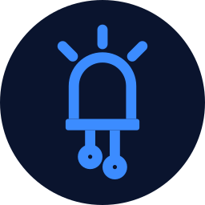

<p align="center"></p>

# designElectronics

**📖 Documentation & screenshots: https://rorretbolt.github.io/designElectronics/**

An open-source electronics design app for **desktop and mobile**, inspired by
[Fritzing](https://fritzing.org). Build a circuit on a virtual breadboard, draw
the schematic, lay out a PCB and export fab-ready Gerber files — on your laptop
or your phone.

Projects are single **`.dez` files** (plain JSON) that embed every part they
use, so they open in any copy of designElectronics, **offline, with no server,
account or extra download**. Share them by email, chat, AirDrop or USB stick.

Built in C++17 with **SDL3** and SDL3_ttf. No other dependencies.

## Features

| Area | What you get |
| --- | --- |
| **Three linked views** | Breadboard, Schematic and PCB. Each part has a position in every view; a connection made in any view shows up in the others as a dashed *ratsnest* line until you wire it there too (just like Fritzing). |
| **Breadboard** | Half+, full+ and mini breadboards with real bus strips and power rails. Part legs snap into holes; holes in use light up green. Moving a breadboard carries the parts plugged into it. |
| **Wiring** | Drag from any pin or hole to draw a wire. Drag a wire to bend it; double-click a bend point to remove it. Wire ends show green (connected) or red (loose). Wire colours on the breadboard; junction dots in the schematic. Click a ratsnest line to turn it into a wire or trace. |
| **PCB** | Board outline with size in mm, single or double-sided, two copper layers, vias and mounting holes. A grid A* **autorouter** with clearances and vias. **DRC** checks clearance, parts off the board and overlapping footprints. |
| **Simulator** | Real-time transient simulation (1 ms steps). Capacitors charge, 555 timers blink LEDs, logic gates, flip-flops, counters (4017, 74HC393) and shift registers (74HC595) clock, op-amps amplify, comparators switch, regulators regulate, relays click, 7-segment displays light up. Multimeters read volts/amps, pushbuttons respond to presses. Overloaded parts *smoke*, with an explanation. Dev boards (Raspberry Pi, ESP32, Pico, Arduino…) supply their power rails and drive pins you configure (`GPIO2=BLINK:500`, `D9=PWM:30`); firmware isn't executed. |
| **Parts library** | 177 entries, searchable, in 17 categories. **Boards:** Raspberry Pi 5, 4 Model B, 3 Model B/B+ and Zero/Zero 2 W (real 40-pin GPIO header), Raspberry Pi Pico/Pico W/Pico 2; Arduino Uno, Uno R4 Minima/WiFi, Leonardo, Mega 2560, Due, Nano, Nano Every, Nano 33 IoT, Nano 33 BLE, Nano ESP32, Nano RP2040 Connect, Micro, Pro Mini, Pro Micro, MKR WiFi 1010; ESP32 DevKitC/DevKit V1/S3/C3 SuperMini, ESP32-CAM, ESP8266 NodeMCU, Wemos D1 Mini; STM32 Blue Pill/Black Pill, Teensy 4.0, Seeed XIAO, Adafruit Feather. **Chips:** ATmega328P, ATtiny85/84, PIC; 74HC00/02/04/08/10/11/14/20/32/86/125/74/138/165/245/393/595/4051, CD4001/4011/4013/4017/4066/4069/4070/4071/4081/4093/4511; LM358/324/741, TL072, NE5532, MCP6002, LM393/339, NE555/556, LM386, TL431, PC817, 4N35, MAX232; ULN2003/2803, L293D, TIP120, IRF540N; LM317, AMS1117, 78L05, 7805; EEPROM, RTC, ADC, I/O expanders, MAX7219, CH340G. **Modules:** L298N, A4988, DRV8825, relay, LM2596, MT3608, TP4056. **Sensors:** LM35, TMP36, DS18B20, DHT11/22, HC-SR04, PIR, MPU-6050, BMP/BME280, VL53L0X, soil moisture, MQ-2, joystick, Hall, IR, sound, HC-05, RC522, NEO-6M, nRF24L01, ADS1115, DS3231. **Displays:** 7-segment (CC/CA), RGB LED, SSD1306 OLED, LCD 16×2, TM1637, MAX7219 matrix, WS2812B, ST7735. Plus the basics: resistors, LEDs, capacitors, diodes, transistors, switches, batteries, breadboards, headers, and a generic DIP IC with any pin count. |
| **Custom parts** | Export any part as a `.dezpart` JSON file, edit it, and import it back. Custom parts can declare their own simulation model (e.g. a logic chip as `NAND 1,2>3`; see docs/FILE_FORMAT.md) and are embedded in your projects automatically. |
| **Export** | Gerber RS-274X + Excellon drill (zipped, ready to upload to a fab), SVG and PNG of any view, Bill of Materials (CSV), XML netlist, SPICE netlist. |
| **Editing** | Undo/redo, copy/cut/paste (clipboard is JSON, so you can paste between windows or apps), duplicate, rotate, flip, z-order, rubber-band selection, notes, snap-to-grid, keyboard nudging. |
| **Mobile-friendly** | Adaptive layout: on narrow screens the parts bin and inspector become slide-over drawers and the toolbar grows larger. One finger pans, two fingers pinch-zoom, long-press opens context menus. Respects safe areas. Autosaves continuously, so nothing is lost if the OS kills the app. |
| **Layers** | A Photoshop-style Layers panel (tab next to Parts; a drawer on phones): toggle each view's layers (PCB: board, top/bottom copper, pads, silkscreen, labels…), see every part with parts plugged into a breadboard grouped under it, click to select, double-click to zoom, hide parts per view, lock them so they can't be moved. Badges flag unrouted connections, parts without a simulation model, damaged parts and live LED brightness. |
| **Version history** | Every save keeps a version on your device, with a summary of what changed ("R1 resistance 220Ω → 330Ω · Added LED2"). **File ▸ Version History** lets you restore any version or open it as a copy — offline, on every platform. |
| **GitHub sync (optional)** | Connect GitHub and **File ▸ Commit to GitHub** commits the design to a private repository you own (each design in its own folder, or its own repo), optionally on every save. Older commits show up in Version History and can be restored from any device. Desktop builds; uses the system's libcurl. |
| **Embed & web** | **File ▸ Embed in a Website** gives you an `<iframe>` for blogs: readers switch views, pan, zoom and run the simulation. The design is packed into the link, so nothing is uploaded. The same app runs in the browser at [rorretbolt.github.io/designElectronics/app](https://rorretbolt.github.io/designElectronics/app/) (WebAssembly). |
| **AI assistants (MCP)** | Run `designElectronics --mcp` and Claude, Cursor or any MCP client can design for you: search parts, add and wire them, plug them into breadboards, simulate, autoroute, run DRC and export Gerbers. Works offline over stdio. See [docs/MCP.md](docs/MCP.md). |
| **Desktop niceties** | Menus, shortcuts, tooltips, trackpad pinch/scroll, drag-and-drop of `.dez` files onto the window, file associations (macOS, Linux). |

## Download

| macOS 11+ (Apple Silicon & Intel) | Windows 10/11 (64-bit) | Linux x86_64 |
| --- | --- | --- |
| [designElectronics-macOS.zip](https://github.com/rORrEtboLt/designElectronics/releases/latest/download/designElectronics-macOS.zip) | [designElectronics-Windows-x64.zip](https://github.com/rORrEtboLt/designElectronics/releases/latest/download/designElectronics-Windows-x64.zip) | [designElectronics-Linux-x86_64.tar.gz](https://github.com/rORrEtboLt/designElectronics/releases/latest/download/designElectronics-Linux-x86_64.tar.gz) |

The builds aren't code-signed yet: on macOS right-click the app ▸ **Open** the first time; on Windows choose **More info ▸ Run anyway**. See the [release notes](https://github.com/rORrEtboLt/designElectronics/releases) for details.

## Build & run (desktop)

You need CMake ≥ 3.20, a C++17 compiler, and SDL3 + SDL3_ttf.

```sh
# macOS
brew install cmake sdl3 sdl3_ttf
# Debian/Ubuntu (24.10+) — or build SDL from source, see docs/BUILDING.md
sudo apt install cmake libsdl3-dev libsdl3-ttf-dev

cmake -S . -B build -DCMAKE_BUILD_TYPE=Release
cmake --build build -j

# macOS
open build/designElectronics.app
# Linux / Windows
./build/designElectronics
```

Open an example: `File ▸ Examples`, or `designElectronics examples/LED_with_battery.dez`.

To build for **iOS and Android**, see [docs/BUILDING.md](docs/BUILDING.md).

### Use it from an AI assistant

```sh
# Claude Code
claude mcp add designElectronics -- "$PWD/build/designElectronics.app/Contents/MacOS/designElectronics" --mcp
```

Then ask: *"Design an ESP32 circuit that blinks an LED on GPIO2, simulate it and save it to ~/blink.dez."*
Setup for Claude Desktop, Cursor and other clients is in [docs/MCP.md](docs/MCP.md).

### Self-test

```sh
./build/designElectronics.app/Contents/MacOS/designElectronics --selftest   # macOS
./build/designElectronics --selftest                                        # elsewhere
```

This runs headless checks over the whole model: every part definition, file
round-trips, connectivity, simulation (LEDs light, the multimeter reads 4.5 V),
autorouting, DRC and every exporter.

## Using it

1. **Breadboard view** — drag parts from the bin (on a phone, tap **Parts** and
   then a part). Push their legs into the breadboard. Drag from a hole to
   another hole or pin to add jumper wires. Press **Simulate** to try it out.
2. **Schematic view** — your breadboard connections appear as dashed lines.
   Arrange the symbols, then click each dashed line (or drag pin to pin) to draw
   the wires. Add ground and power symbols; symbols with the same name connect.
3. **PCB view** — size the board in the Inspector, arrange the footprints,
   press **Autoroute**, then **DRC**. Export Gerbers from **Export ▸ Gerber**.
4. **Share** — **Save / Share** writes a `.dez` file. Anyone with
   designElectronics can open it on any platform.

Keyboard shortcuts are listed under **Help ▸ Keyboard & Touch Shortcuts**.

## Project layout

```
src/
  main.cpp       SDL3 main callbacks, CLI (--selftest, --screenshot, …)
  app.*          application state, file I/O, undo, editing commands
  canvas.cpp     view rendering and pointer/touch interaction
  panels.cpp     top bar, menus, parts bin, inspector, toolbar
  ui.*           small immediate-mode UI toolkit
  gfx.*          anti-aliased 2D drawing + cached text on SDL_Renderer
  partlib.*      part definitions and the built-in library
  doc.*          document model, .dez format, connectivity / ratsnest
  router.cpp     PCB autorouter        drc.cpp     design rules check
  sim.cpp        simulator             export.cpp  Gerber/SVG/BOM/netlist/SPICE
  examples.cpp   built-in example projects
  mcp.cpp        MCP server for AI assistants (--mcp)
  logo.cpp       the logo, a blue LED (top bar, window icon, --export-logo)
  history.cpp    local version history + GitHub REST client
  app_history.cpp Version History / Commit / GitHub Account screens
  json.*         tiny JSON parser/writer
assets/fonts/    Lato + Source Code Pro (SIL OFL)
assets/icon/     logo (SVG) and app icon PNGs
platform/        Info.plist (macOS/iOS), Linux .desktop + MIME, Android notes
examples/        example .dez projects
docs/            file format spec, build guide, MCP guide
tests/           MCP smoke test, GitHub sync test (local mock API)
```

## Contributing

Parts are the easiest way to contribute: add a generator in `src/partlib.cpp`
(three small vector drawings + pin positions) and register it in
`generators()` and `partLibrary()`. Run `--selftest` before sending a PR.

## License

Code: MIT (see [LICENSE](LICENSE)). Fonts: SIL Open Font License 1.1
(see [assets/fonts/OFL.txt](assets/fonts/OFL.txt)).

designElectronics is an independent project and is not affiliated with the
Fritzing project. It doesn't read Fritzing's `.fzz` files.
